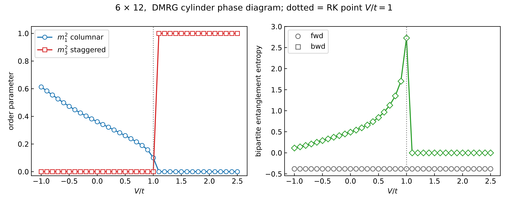

# Example: the square-lattice quantum dimer model (QDM)

The `tenpy_gpu_addon` demo model. Files:

- **[`qdm_model.py`](qdm_model.py)** — the model (`SquareQDM`) and observables
  (`structure_factors`, `dimer_density`). Plain tenpy; nothing in it knows
  about torch or the addon.
- **[`run_qdm.py`](run_qdm.py)** — build → `run_dmrg_torch` (GPU loop) →
  measure with `DeviceMPS`, using the *same* observable code you'd run on a
  tenpy MPS.
- **[`run_gpu_sweep.py`](run_gpu_sweep.py)** — a **model-agnostic** parameter-
  sweep driver. 
- **[`qdm_phase_diagram.py`](qdm_phase_diagram.py)** — the worked example: wires
  the QDM into `run_gpu_sweep`, scans the coupling `V`, and plots the phase
  diagram from the lowest-energy state at each point.

The model is doesn't take advantage of charge conservation (`LegCharge.from_trivial`): every
npc tensor is a single dense block, which is what the addon's torch backends
require. If you adapt this to your own model, keep `conserve=None`.

---

## 1. Hamiltonian

The square-lattice QDM  proposed by Rokhsar & Kivelson, *Phys. Rev. Lett.* **61**,
2376 (1988). Dimers
live on the edges of a square lattice; a *dimer covering* places exactly one
dimer on every vertex (a perfect matching). The Hamiltonian acts on the space
of coverings with a kinetic (ring-exchange) term and a diagonal (potential)
term, plaquette by plaquette:

$$
H = -t \sum_{\square} \Big( |{=}\rangle\langle{\||}| + |{\||}\rangle\langle{=}|  \Big) + V \sum_{\square} \Big(  |{=}\rangle\langle{=}| + |{\||}\rangle\langle{\||}|  \Big)
$$

- **Kinetic, $`-t`$:** the plaquette *flip*. On any plaquette carrying two
  parallel dimers, exchange the two horizontal dimers ($`=`$) for the two
  vertical ones ($`\|`$), and vice-versa (the $`+\text{h.c.}`$). Off-diagonal;
  this is the only term that moves dimers.
- **Diagonal, $`V`$:** counts *flippable* plaquettes (those with two parallel
  dimers). $`V<0`$ rewards flippability, $`V>0`$ penalises it.

The default `t=1, V=0` sits in the
kinetic-dominated regime; **the phase diagram is the $`V/t`$ axis** (columnar
at $`V/t \to -\infty`$, the RK point at $`V/t = 1`$, staggered for $`V/t > 1`$),
which is what the two order parameters in §4 are built to resolve.

`model_params` (defaults): `Lx=6, Ny=12, bc_MPS='finite', t=1.0, V=0.0,
V_blockade=50.0`.

---

## 2. Geometry — cylinder, A/B two-colouring

An `Lx × Ny` square lattice wrapped into a **cylinder**: periodic around the
circumference `x` (of *even* width `Lx`, required for the colouring below),
open or periodic along the axis `y` (`bc_MPS='finite'` or `'infinite'`). The
`Ny` sites along the axis are the "rings".

Vertices are two-coloured like a checkerboard, `is_A(x,y) = (x+y) % 2 == 0`:

- **A-vertices** carry the physical sites (see §3).
- **B-vertices** carry no site; their matching constraint is imposed as an
  interaction (§3).

Each edge (bond) is *owned* by exactly one A-vertex, as one of that vertex's
four legs (`bond_owner`): leg **0 = right, 1 = left, 2 = up, 3 = down**. The
MPS is the 1-D chain of the A-vertices (`nS` of them); `build_cylinder`
returns the geometry helpers (`mps_index`, `bond_exists`, `plaquette_corners`,
…) that map lattice bonds/plaquettes to MPS sites and legs. On a finite
cylinder, dimers on non-existent boundary legs are forbidden by a large
on-site penalty (`INERT`).

For `Lx=6, Ny=6, bc_MPS='finite'`: 18 A-sites, MPO bond dimension 26.

---

## 3. The 4-state vertex site + the blockade idea

The usual QDM lives on bonds with a hard one-dimer-per-vertex constraint.
Here we push the constraint into the site definition on *half* the lattice:

**Each A-vertex is a single 4-state site.** Its basis
$`|1\rangle,|2\rangle,|3\rangle,|4\rangle`$ means *"my dimer points along leg
$`k`$ "* (right/left/up/down). There is **no empty state**, so *"exactly one
dimer touches this A-vertex"* is built in for free — no constraint needed on
the A-sublattice. On-site operators: $`n_k = |k\rangle\langle k|`$ (leg- $`k`$
occupation) and the ladder operators $`T_{ab} = |a\rangle\langle b|`$ that
move the dimer from leg $`b`$ to leg $`a`$ (these build the plaquette flip).

**The B-vertices get no site.** Their matching constraint — *exactly one
dimer touches each B-vertex* — is not automatic, so it is imposed
**softly**: for every pair of legs meeting at a B-vertex,

$$
H_{\text{match}} = \sum_{B}\ \sum_{(a,b)\ \text{at}\ B} n_a n_b
$$

a penalty $`V_{\text{blockade}}\,n_a n_b`$ for two dimers touching the same
B-vertex (a **blockade**: they exclude each other). With $`V_{\text{blockade}}`$
large, states that double-cover or leave a B-vertex bare are pushed far up in
energy, and the low-energy manifold is exactly the perfect matchings. "Soft"
(a penalty) rather than "hard" (a projector) because a finite, dense
blockade is what the charge-free GPU backend can represent and DMRG can relax
into. The default `V_blockade=50` is well inside the "effectively hard"
regime for this model.

---

## 4. Order parameters

`structure_factors(psi, geo)` returns two **intensive** dimer structure
factors, both of the form

$$
m^2 = \frac{\langle O^\dagger O\rangle}{(N_{\text{vert}}/2)^2},
\qquad
O = \sum_{\text{bonds } b} \phi_b n_b
$$

where $`n_b`$ is the occupation of bond $`b`$ and the phase pattern is
$`\phi_b = e^{\,i\mathbf{k}\cdot\mathbf{r}_b}`$ at the ordering wavevector
$`\mathbf{k}`$ of the pattern being tested. Each $`m^2`$ is thus (up to the
normalisation) the **dimer structure factor $`S(\mathbf{k})`$ at that
$`\mathbf{k}`$**. The $`1/(N_{\text{vert}}/2)^2`$ normalisation — the square of
the number of dimers in a covering — is chosen so that $`m^2 = 1`$ for a
*perfectly ordered* covering (every dimer contributes coherently) and
$`m^2 \to 0`$ in the disordered phase as the system grows. Internally it needs
the $`4\times4`$ bond–bond correlation matrix $`\langle n_a n_b\rangle`$, built
from tenpy's `correlation_function` / `expectation_value` — so it runs
unchanged on a `DeviceMPS`.

These are the standard columnar and staggered valence-bond-solid order
parameters for square-lattice dimers (similar to the one used in Sachdev, *Phys. Rev. B* **40**, 5204
(1989), but with a different scaling factor to make it intensive).

- **Columnar order parameter, $`m_1^2`$** (`chi1`, phase `phase_theta`):
  ordering wavevector $`\mathbf{k} = (\pi, 0)`$ / $`(0, \pi)`$ —
  $`\phi = (-1)^x`$ on horizontal bonds and $`-i\,(-1)^y`$ on vertical bonds, the
  complex combination that folds the two $`C_4`$-related columnar patterns into
  one order parameter. Equals **1 in a perfect columnar covering** (dimers
  aligned into parallel columns, breaking rotational and one translational
  symmetry) and is large throughout the columnar phase, dominant at
  $`V/t \to -\infty`$.

- **Staggered order parameter, $`m_3^2`$** (`chi3`, phase `phase_zeta`):
  ordering wavevector $`\mathbf{k} = (\pi, \pi)`$ — $`\phi = (-1)^{x+y}`$ (with
  the same $`-i`$ on vertical bonds). Equals **1 in the perfect staggered
  covering** (the maximally-tilted, flip-frozen state with zero flippable
  plaquettes) and is dominant for $`V/t > 1`$, beyond the RK point.

A scan over $`V/t`$ tracking $`(m_1^2, m_3^2)`$ therefore maps the phase diagram:
$`m_1^2 \to 1`$ on the columnar side, $`m_3^2 \to 1`$ on the staggered side, and
both small near the RK point / any intermediate liquid-like regime.

`dimer_density(psi, geo)` returns $`\langle`$ total dimer occupation
$`\rangle / N_{\text{bonds}}`$ — fixed for a valid covering, so it is a **sanity check**
that the blockade is doing its job, not an order parameter.

---

## Running it

```bash
# laptop-friendly default (Lx=4, Ny=4, chi=128, CPU or GPU auto)
python run_qdm.py

# production-ish point on a GPU
python run_qdm.py --Lx 6 --Ny 6 --V 0.0 --chi 512 --device cuda
```

`run_qdm.py` uses a 2-sweep symmetry-breaking warm seed because the QDM's
product states are *dark states* of the plaquette kinetic term (a plain cold
start stalls at $`E=0`$ — a property of the model, not the engine) and a staged
`chi_list` ramp with the mixer re-armed at each step. Timing/scaling numbers
for this model are in [`../bench/README.md`](../bench/README.md).

---

## 5. Phase diagram

```bash
# tiny CPU smoke test (default)
python qdm_phase_diagram.py

# production scan on a GPU
python qdm_phase_diagram.py --Lx 6 --Ny 6 --chi 512 --device cuda \
    --Vmin -2 --Vmax 3 --nV 21 --out-dir pd_6x6
```

This scans the coupling `V` (at fixed `t=1`) and writes, per point, a
self-contained `.npz` (observables + full per-sweep convergence record), then
`phase_diagram.npz` and `phase_diagram.png`. The protocol (in
[`run_gpu_sweep.py`](run_gpu_sweep.py)) runs two **warm chains** seeded from
the classical crystals and takes, at each `V`, the **lowest-energy** result
(variational principle):

- **forward** — seeded low→high `V`, anchored in the **columnar** covering;
- **backward** — seeded high→low `V`, anchored in the **staggered** covering;
- their energies cross at the transition; deep in either phase the fixed-χ
  result is history-dependent, which is why min-energy is the estimator.

The **classical anchor seeds** are the exact `t=0` ground states — product
coverings with $`m_1^2 = 1`$ (columnar) or $`m_3^2 = 1`$ (staggered), whichever
is lower in energy at that `V`. Unlike a plain product cold start these
*escape the dark state*, because the columnar covering carries flippable
plaquettes the kinetic term acts on. (A cold, product-seeded chain is `--cold`,
off by default: it dark-stalls at $`E=0`$, χ=1 for the QDM.)



### Reusing the driver for your own model

[`run_gpu_sweep.py`](run_gpu_sweep.py) is model-agnostic — send a collaborator
the folder and they only replace three callbacks (copy `qdm_phase_diagram.py`
as a template):

| callback | returns | for the QDM |
|---|---|---|
| `build_model(value)` | a charge-free tenpy model with `.lat`, `.geo` | `SquareQDM` at coupling `value` |
| `measure(state, geo)` | dict of scalar observables (`state` is a `DeviceMPS` or tenpy MPS) | `m1sq`, `m3sq`, `density` |
| `classical_seed(model, value)` | `(psi0, E_classical)` product-state anchor, or omit for a cold anchor | lower of the columnar / staggered coverings |

`run_gpu_sweep`'s schedule (staged χ ramp, mixer re-arm, warm-chain anchor
budget) is exactly the engine-development protocol and needs no changes.

---

## 6. A worked experiment: the 6×12 phase diagram

What we actually ran, and the lessons for choosing an initialization. All runs:
`SquareQDM` **Lx=6 × Ny=12 finite**, `t=1`, `V_blockade=50`, scanning
**V/t ∈ [−1, 2.5] in 21 points**, on an A100.

**Result (canonical run, `phase_diagram_6_12`):** warm forward/backward with
classical anchors, χ=256, `max_sweeps=60`. Columnar order ($`m_1^2`$) on the
$`V/t<1`$ side, staggered ($`m_3^2=1`$) for $`V/t>1`$, with the transition landing
cleanly at the **RK point $`V/t=1`$**. The forward (columnar) and backward
(staggered) chains cross there; `combine_min_energy` picks the winner per
point. Command:

```bash
python qdm_phase_diagram.py --Lx 6 --Ny 12 --chi 256 --device cuda \
    --Vmin -1 --Vmax 2.5 --nV 21 --max-sweeps 60 --out-dir qdm_runs/phase_diagram_6_12
```

### Choosing the initialization — the dark-state trap

The QDM's product coverings are **dark states** of the plaquette kinetic term
($`H|\psi\rangle=0`$ exactly; the staggered `[0]*nS` covering has zero flippable
plaquettes). We tested four ways to seed the sweep:

| init / anchor | how | outcome on the torch loop |
|---|---|---|
| **classical columnar/staggered anchor** | default | **works** — columnar seed is *not* dark (has flippable plaquettes); matches stock tenpy to ~1e-13 |
| **cold-from-random** per point | `--cold-random` | **works** — a random MPS is not the dark eigenstate; gives the lowest energies (best branch selection), but every point is an expensive independent cold start |
| **cold `[0]*nS` product** per point | (tested, not kept) | **stalls** at $`E=0`$, χ=1 (dark) |
| **warm chain, `[0]*nS` anchor** | (tested, not kept) | **stalls** (dark anchor never escapes) |

So on this engine, **anchor on a non-dark state** (the classical columnar
covering, or a random state) — not the bare product state.

### Two caveats when reading the numbers

- **Convergence budget.** `max_sweeps=30` leaves the *deep-columnar* tail
  ($`V/t \le -1.25`$) unconverged (`converged=False`, energy still descending,
  entropy still climbing) — those $`m_1^2`$ values are still-relaxing snapshots.
  The mid-columnar region ($`V/t=-1.0\to0.75`$) does converge. The columnar
  phase is genuinely entangled ($`S_\text{mid}\sim2`$) and needs many more
  sweeps than the frozen staggered side; χ=256 converges *cleaner* partly
  because the smaller bond dimension caps entropy growth (so the stop fires),
  not because it is more accurate than a longer-swept χ=512 run.
- **Engine note — the mixer and dark states. (check if this is correct?)** Stock tenpy's
  `DensityMatrixMixer` *can* escape the `[0]` dark state (its perturbation
  builds from partial, left-only-contracted H-terms that are nonzero even when
  $`H|\psi\rangle=0`$); this addon's simplified density-matrix mixer produces a
  nonzero but *ineffective* perturbation there (the bond grows but the added
  directions carry zero weight, so the energy never drops). This only affects
  the `[0]`-seeded recipes above — it is why we anchor on the non-dark
  classical covering instead. The `dropin` engine (`TorchTwoSiteDMRGEngine`)
  uses tenpy's mixer verbatim, so routing a dark anchor through it would
  escape, if a `[0]`-anchor protocol is ever required.
- **Cold-start caveat (shared with tenpy, not specific to this mixer).** A
density-matrix mixer perturbs ρ by `h·θ` terms, so if the initial product state
is a *dark state* of the off-diagonal Hamiltonian (`h·θ = 0`) there is nothing to
inject and *no* such mixer can escape it. The QDM's natural product states are
dark states of the plaquette kinetic term, so a cold start stalls at E=0 with chi
pinned at 1 — in stock tenpy exactly as here. Seed with a warm start (a couple of
stock tenpy sweeps, or a random-bond-dimension MPS) as `examples/run_qdm.py`
does. This is a property of the model, not the engine.